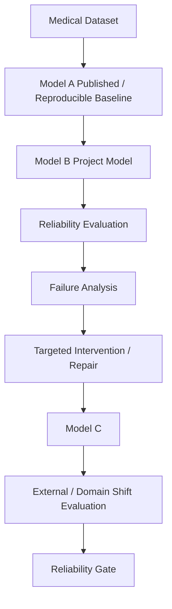

# NeuroShield

NeuroShield is a two track medical AI reliability project focused on neurological imaging. Each track targets a distinct clinical task and dataset, developed independently but following a shared methodology for building and evaluating models.

The project is not only about training models. It follows a reliability oriented workflow involving baseline reproduction, a project selected model, reliability evaluation, systematic failure analysis, targeted repair, a repaired model (Model C), external or domain shift evaluation, and a final reliability assessment.

The two tracks, Alzheimer's disease classification and brain tumor segmentation, are developed in parallel and are currently at different stages of this workflow.

## Common Project Flow



This workflow is applied independently to both tracks while the tracks are developed in parallel.

## Two Track Overview

| Track | Clinical Task | Dataset | Model A | Model B | Current Status |
|---|---|---|---|---|---|
| Track 1 | Alzheimer's disease classification | OASIS | Published / reproducible OASIS classifier | ViT B/16 | Model B complete; Model A remaining |
| Track 2 | Brain tumor segmentation | BraTS 2020 | 2D nnU-Net | UNETR | Model A training completed; checkpoint persistence and outer test evaluation remaining |

## Datasets

### Track 1: OASIS

- Used for Alzheimer's disease classification
- Fixed subject level train, validation, and test split
- Current split: 164 training, 35 validation, 36 test scans

### Track 2: BraTS 2020

- Brain tumor segmentation dataset
- Four MRI modalities: FLAIR, T1, T1ce, T2
- 368 usable cases after validation
- Fixed split: 257 train, 55 validation, 56 outer test

## Track 1: Alzheimer's Disease Classification

### Dataset

Fixed split: 164 training, 35 validation, 36 test scans.

### Model A

Model A is the required published or reproducible OASIS classification baseline.

Current status: Remaining.

### Model B: ViT B/16

Completed components:

- 2.5D multi slice MRI input
- ImageNet pretrained ViT B/16
- 12 example overfit sanity test
- Three seeds: 42, 123, 2024
- Scan level held out test evaluation
- Saved results, configuration, and checkpoints

Final Model B results:

| Metric | Value |
|---|---|
| Accuracy | 0.7130 ± 0.0131 |
| Balanced Accuracy | 0.7127 ± 0.0157 |
| Sensitivity | 0.7111 ± 0.0314 |
| Specificity | 0.7143 ± 0.0000 |
| F1 | 0.6734 ± 0.0200 |
| ROC AUC | 0.7386 ± 0.0120 |

### Remaining Work

- Model A
- Reliability / uncertainty evaluation
- Calibration
- OOD / domain shift evaluation
- Failure analysis
- VAE + Latent Diffusion intervention
- Model C
- ADNI external validation
- Final reliability evaluation

## Track 2: Brain Tumor Segmentation

### Dataset

- BraTS 2020
- 368 usable cases
- 257 train, 55 validation, 56 outer test
- FLAIR, T1, T1ce, T2

### Model A: 2D nnU-Net

- nnU-Net v2
- 2D configuration
- Fold 0
- nnUNetTrainer_100epochs
- 100 epochs
- Training completed
- Internal validation mean Dice: 0.765127

Model A training is complete, but the required persistent checkpoint or configuration artifact was not successfully preserved in the first run because the verification stage expected configuration files in the wrong location.

Status:

- Model A training: complete
- Persistent artifact: remaining
- Outer test evaluation: remaining

### Model B

Model B is UNETR. Status: remaining.

### Remaining Work

- Corrected Model A artifact persistence
- Model A outer test inference and evaluation
- Model B (UNETR)
- Reliability / failure analysis
- Model C
- Comparative evaluation

## Parallel Development Status

| Stage | Track 1: Alzheimer's | Track 2: Brain Tumor |
|---|---|---|
| Dataset preparation | Complete | Complete |
| Model A | Remaining | Training complete; persistence / evaluation remaining |
| Model B | Complete | Remaining |
| Reliability evaluation | Remaining | Remaining |
| Failure analysis | Remaining | Remaining |
| Model C | Remaining | Remaining |
| External / domain shift | ADNI remaining | Remaining |
| Reliability Gate | Remaining | Remaining |

## Repository Structure

```
Neuroshield/
├── notebooks/
│   ├── alzheimers/
│   └── braintumor/
├── src/
│   ├── alzheimers/
│   └── braintumor/
├── outputs/
│   ├── alzheimers/
│   └── braintumor/
├── .gitignore
├── .gitattributes
└── requirements.txt
```

Large datasets are maintained separately, and large model checkpoints are versioned with Git LFS where required.

## Overall Status

The two tracks are being developed in parallel. Track 1 Model B is complete while Model A remains. Track 2 Model A training is complete, but artifact persistence and outer test evaluation remain. The common reliability, failure analysis, Model C, and external / domain shift stages remain across both tracks.